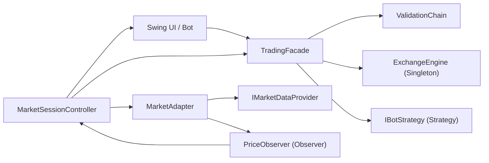

# Nội dung thuyết trình: Mẫu thiết kế trong Trading Simulator

> Tài liệu này là kịch bản nội dung theo từng slide để đưa vào PowerPoint/Google Slides. Mỗi
> slide gồm nội dung hiển thị và ghi chú nói. Dùng kèm
> [đặc tả phân tích mẫu thiết kế](./DESIGN_PATTERNS_SPEC.md).

## Slide 1 — Mẫu thiết kế trong Trading Simulator

**Nội dung trên slide**

- Dự án mô phỏng giao dịch chứng khoán ngoại tuyến
- Java 17 · Maven · Swing
- Bốn mẫu tiêu biểu: Singleton · Facade · Observer · Strategy
- Bốn thành viên — mỗi thành viên trình bày một mẫu

**Ghi chú thuyết trình**

Giới thiệu mục tiêu: trình bày cách các mẫu thiết kế đang giải quyết vấn đề cụ thể trong mã
nguồn, không chỉ định nghĩa lý thuyết. Bốn người trình bày lần lượt một mẫu đại diện trong phần
việc của mình.

## Slide 2 — Bối cảnh ứng dụng

**Nội dung trên slide**

- Xem quote và danh mục, đặt lệnh Market/Limit/Stop-loss
- Bot giao dịch dùng MA, RSI, MACD hoặc Bollinger Bands
- Dữ liệu giá mô phỏng/CSV; chạy không cần sàn thật hay mạng
- `BigDecimal` cho tiền/giá; `double` cho tính chỉ báo

**Ghi chú thuyết trình**

Nhấn mạnh đây là simulator để minh họa kiến trúc và hành vi giao dịch; không phải hệ thống đặt
lệnh lên sàn thật. Mẫu thiết kế giúp tách trạng thái, quy trình nghiệp vụ, sự kiện và thuật toán.

## Slide 3 — Tổng quan hệ thống và chức năng

**Nội dung trên slide**

- **Hệ thống gì?** Ứng dụng desktop mô phỏng giao dịch chứng khoán, chạy offline; không kết nối
  sàn thật.
- **Mục tiêu:** minh họa luồng nhận giá → phân tích/đặt lệnh → cập nhật danh mục.
- **Chức năng chính:** xem bảng giá; đặt lệnh Market/Limit/Stop-loss; theo dõi tiền mặt, vị thế,
  lịch sử và lệnh chờ; chạy bot với MA/RSI/MACD/Bollinger Bands.

| Chức năng trong hệ thống | Mẫu tiêu biểu | Thành viên | Vai trò |
|---|---|---|---|
| Dùng chung trạng thái tiền, vị thế, quote và giao dịch | Singleton | TV1 | `ExchangeEngine` là engine duy nhất trong tiến trình |
| Cung cấp thao tác nghiệp vụ đặt lệnh cho UI và bot | Facade | TV2 | `TradingFacade` điều phối kiểm tra và thực thi |
| Cập nhật các thành phần khi có quote mới | Observer | TV3 | `MarketAdapter` phát quote tới subscriber |
| Thay thuật toán sinh tín hiệu giao dịch | Strategy | TV4 | Bot chọn MA, RSI, MACD hoặc Bollinger Bands |

**Ghi chú thuyết trình**

Nói ngắn gọn ứng dụng là một môi trường thực hành mô phỏng, không phải phần mềm giao dịch trực
tiếp. Hãy đi từ nhu cầu người dùng — theo dõi giá, đặt lệnh, xem danh mục hoặc bật bot — tới mẫu
thiết kế hỗ trợ chức năng đó. Các mẫu không thay thế nhau: Singleton quản lý thể hiện engine
dùng chung; Facade gom lối vào nghiệp vụ; Observer phân phối quote; Strategy cho phép hoán đổi
thuật toán của bot.

## Slide 4 — Sơ đồ kiến trúc tổng quan

**Nội dung trên slide**

**Ghi chú thuyết trình**

Luồng quote đi từ provider qua adapter và observer tới session controller, sau đó cập nhật
facade, lệnh chờ, bot và giao diện. Luồng đặt lệnh đi từ UI/bot qua facade, validation rồi tới
engine. Bốn mẫu được chọn tương ứng với bốn trách nhiệm khác nhau.

## Slide 5 — TV1: Singleton cho ExchangeEngine

**Nội dung trên slide**

- **Vấn đề:** UI và bot phải cùng thấy tiền, vị thế, quote và lịch sử giao dịch
- `private` constructor + `static final INSTANCE`
- `getInstance()` trả về engine duy nhất trong tiến trình
- Các thao tác cập nhật trạng thái được đồng bộ hóa

**Ghi chú thuyết trình**

Trong `Main` và `MainWindow`, ứng dụng lấy engine bằng `ExchangeEngine.getInstance()` rồi truyền
vào `TradingFacade`. `TestCore` kiểm tra hai lần gọi trả cùng tham chiếu. Cần lưu ý Singleton có
thể gây trạng thái toàn cục và làm khó chạy nhiều tài khoản độc lập trong cùng tiến trình.

## Slide 6 — TV2: Facade cho luồng giao dịch

**Nội dung trên slide**

- **Vấn đề:** client không nên tự điều phối engine, validation, adapter và sổ lệnh
- `TradingFacade` là API nghiệp vụ cho UI và bot
- Ví dụ: lấy quote → kiểm tra → thực thi lệnh
- Bot hỏi tín hiệu và gửi lệnh thông qua facade

**Ghi chú thuyết trình**

Minh họa bằng `submitMarketOrder`: client đưa symbol, chiều và số lượng; facade lấy báo giá,
kiểm tra lệnh, rồi gọi engine. Facade giúp đơn giản hóa client, nhưng phải tránh biến thành một
lớp ôm mọi trách nhiệm.

## Slide 7 — TV3: Observer cho cập nhật quote

**Nội dung trên slide**

- **Subject:** `MarketAdapter`
- **Observer contract:** `IPriceObserver.onPrice(Quote)`
- **Observer cụ thể:** `PriceObserver`
- `MarketSessionController` đăng ký callback xử lý quote
- Một quote có thể cập nhật UI, facade, bot và listener

**Ghi chú thuyết trình**

`MarketAdapter.refresh(symbol)` lấy quote rồi lần lượt thông báo những observer đã đăng ký.
`MarketSessionController` kết nối callback `handleQuote` để chuyển quote tới phần còn lại của
ứng dụng. Triển khai hiện tại phát đồng bộ và chưa có API hủy đăng ký; đây là điểm cần cân nhắc
khi mở rộng vòng đời phiên.

## Slide 8 — TV4: Strategy cho bot

**Nội dung trên slide**

- **Vấn đề:** đổi thuật toán sinh tín hiệu mà không viết lại luồng bot
- Giao diện chung: `IBotStrategy`
- Concrete strategy: MA · RSI · MACD · Bollinger Bands
- `TradingFacade` giữ strategy hiện tại; UI có thể thay lựa chọn
- Kết quả: `BUY`, `SELL` hoặc chưa có tín hiệu

**Ghi chú thuyết trình**

`BotController` quản lý lịch sử giá và gọi strategy qua facade. Strategy chỉ quyết định tín hiệu;
facade/engine vẫn xử lý validation và giao dịch. Các lớp chiến lược được kiểm thử riêng trong
`TestStrategies`.

## Slide 9 — Các mẫu phối hợp trong một phiên

**Nội dung trên slide**

1. Singleton cung cấp trạng thái engine dùng chung
2. Observer chuyển quote mới đến session controller
3. Strategy phân tích lịch sử giá và tạo tín hiệu
4. Facade điều phối kiểm tra và gửi lệnh đến engine

**Ghi chú thuyết trình**

Kể một kịch bản: phiên nhận quote mới, bot cập nhật lịch sử, chiến lược phát tín hiệu BUY, facade
kiểm tra điều kiện lệnh rồi yêu cầu engine cập nhật số dư và vị thế. Mỗi mẫu giải quyết một phần
riêng; không mẫu nào thay thế trách nhiệm của các mẫu còn lại.

## Slide 10 — Lợi ích và đánh đổi

**Nội dung trên slide**

| Mẫu | Lợi ích chính | Đánh đổi chính |
|---|---|---|
| Singleton | Một trạng thái engine thống nhất | Trạng thái toàn cục, khó nhiều phiên |
| Facade | API client đơn giản | Có thể phình thành lớp ôm đồm |
| Observer | Nơi phát không phụ thuộc subscriber | Thứ tự/lỗi/vòng đời đăng ký |
| Strategy | Dễ thay và kiểm thử thuật toán | Tăng số lớp; cần hợp đồng ổn định |

**Ghi chú thuyết trình**

Mẫu thiết kế không tự động làm hệ thống tốt hơn. Chọn mẫu khi lợi ích về tách biệt và thay đổi
thực sự lớn hơn độ phức tạp thêm vào. Cũng cần kiểm thử các giới hạn: Singleton cần reset giữa
test, Observer cần quản lý subscriber, Strategy cần quy ước khi thiếu dữ liệu.

## Slide 11 — Kiểm chứng và kết luận

**Nội dung trên slide**

- Kiểm thử: `TestCore`, `TestPatterns`, `TestStrategies`
- Chạy test: `mvn -o -Dmaven.repo.local=.m2 test`
- Mỗi mẫu có một trách nhiệm rõ trong luồng giao dịch
- Tài liệu chi tiết: `docs/DESIGN_PATTERNS_SPEC.md`

**Ghi chú thuyết trình**

Kết luận bằng việc nối lại bốn vai trò: Singleton giữ trạng thái engine; Facade cung cấp lối vào
nghiệp vụ; Observer phân phối quote; Strategy cho phép thay thuật toán bot. Mời người nghe đặt
câu hỏi hoặc xem test tương ứng để kiểm chứng hành vi.

## Gợi ý phân chia thời lượng

| Người trình bày | Slide | Thời lượng gợi ý |
|---|---:|---:|
| Mở đầu / tổng quan hệ thống / kiến trúc | 1–4 | 3 phút |
| Thành viên 1 — Singleton | 5 | 1–2 phút |
| Thành viên 2 — Facade | 6 | 1–2 phút |
| Thành viên 3 — Observer | 7 | 1–2 phút |
| Thành viên 4 — Strategy | 8 | 1–2 phút |
| Cả nhóm — phối hợp, đánh đổi, kết luận | 9–11 | 2–3 phút |
