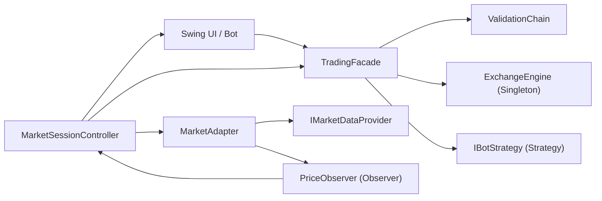
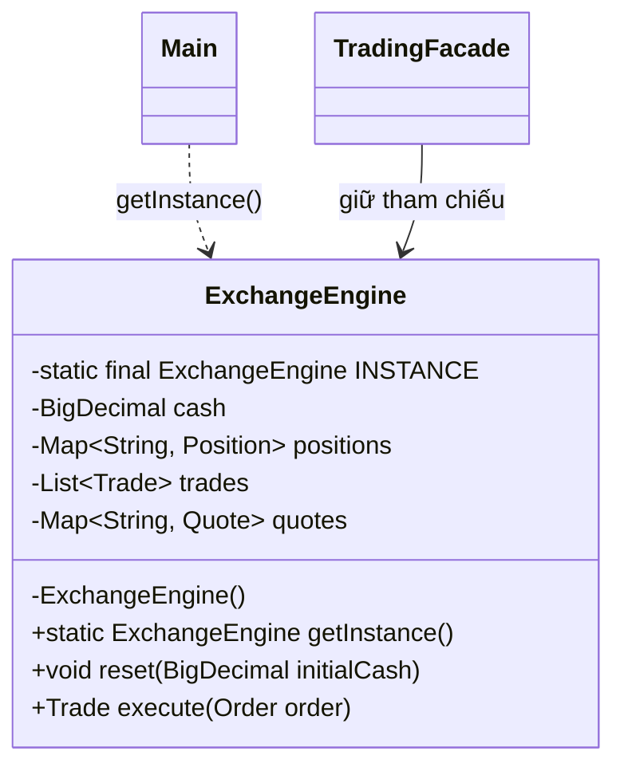
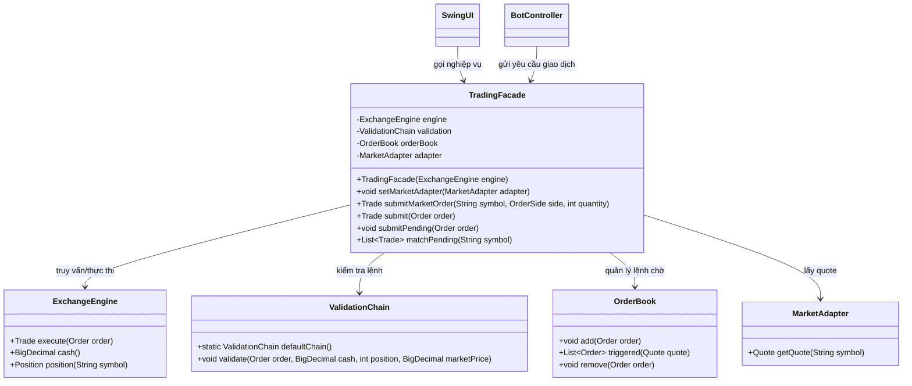
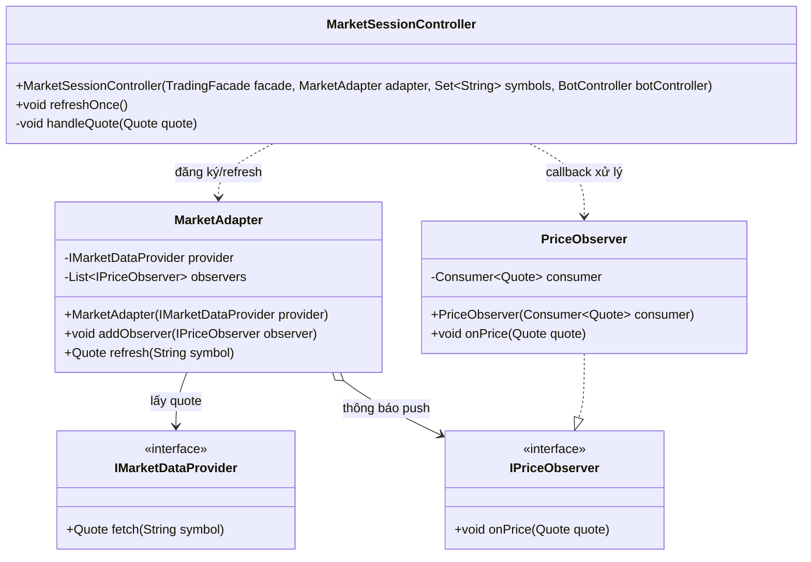
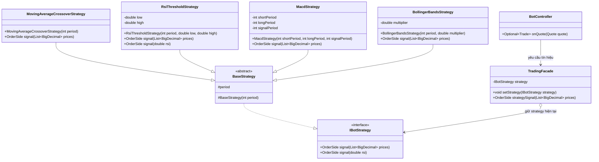

# Nội dung thuyết trình: Mẫu thiết kế trong Trading Simulator

> Tài liệu này là kịch bản nội dung theo từng slide để đưa vào PowerPoint/Google Slides. Mỗi
> slide gồm nội dung hiển thị và ghi chú nói. Dùng kèm
> [đặc tả phân tích mẫu thiết kế](./DESIGN_PATTERNS_SPEC.md).

## Slide 1 — Mẫu thiết kế trong Trading Simulator

**Nội dung trên slide**

- Dự án mô phỏng giao dịch chứng khoán ngoại tuyến
- Java 17 · Maven · Swing
- Bốn mẫu tiêu biểu: Singleton · Facade · Observer · Strategy
- Bốn thành viên — mỗi thành viên trình bày một mẫu

**Ghi chú thuyết trình**

Giới thiệu mục tiêu: trình bày cách các mẫu thiết kế đang giải quyết vấn đề cụ thể trong mã
nguồn, không chỉ định nghĩa lý thuyết. Bốn người trình bày lần lượt một mẫu đại diện trong phần
việc của mình.

## Slide 2 — Bối cảnh ứng dụng

**Nội dung trên slide**

- Xem quote và danh mục, đặt lệnh Market/Limit/Stop-loss
- Bot giao dịch dùng MA, RSI, MACD hoặc Bollinger Bands
- Dữ liệu giá mô phỏng/CSV; chạy không cần sàn thật hay mạng
- `BigDecimal` cho tiền/giá; `double` cho tính chỉ báo

**Ghi chú thuyết trình**

Nhấn mạnh đây là simulator để minh họa kiến trúc và hành vi giao dịch; không phải hệ thống đặt
lệnh lên sàn thật. Mẫu thiết kế giúp tách trạng thái, quy trình nghiệp vụ, sự kiện và thuật toán.

## Slide 3 — Tổng quan hệ thống và chức năng

**Nội dung trên slide**

- **Hệ thống gì?** Ứng dụng desktop mô phỏng giao dịch chứng khoán, chạy offline; không kết nối
  sàn thật.
- **Mục tiêu:** minh họa luồng nhận giá → phân tích/đặt lệnh → cập nhật danh mục.
- **Chức năng chính:** xem bảng giá; đặt lệnh Market/Limit/Stop-loss; theo dõi tiền mặt, vị thế,
  lịch sử và lệnh chờ; chạy bot với MA/RSI/MACD/Bollinger Bands.

| Chức năng trong hệ thống | Mẫu tiêu biểu | Thành viên | Vai trò |
|---|---|---|---|
| Dùng chung trạng thái tiền, vị thế, quote và giao dịch | Singleton | Phan Thành Huy | `ExchangeEngine` là engine duy nhất trong tiến trình |
| Cung cấp thao tác nghiệp vụ đặt lệnh cho UI và bot | Facade | Dương Văn Minh | `TradingFacade` điều phối kiểm tra và thực thi |
| Cập nhật các thành phần khi có quote mới | Observer | Lê Thị Ánh Nhung | `MarketAdapter` phát quote tới subscriber |
| Thay thuật toán sinh tín hiệu giao dịch | Strategy | Lý Ngọc Thảo Nguyên | Bot chọn MA, RSI, MACD hoặc Bollinger Bands |

**Ghi chú thuyết trình**

Nói ngắn gọn ứng dụng là một môi trường thực hành mô phỏng, không phải phần mềm giao dịch trực
tiếp. Hãy đi từ nhu cầu người dùng — theo dõi giá, đặt lệnh, xem danh mục hoặc bật bot — tới mẫu
thiết kế hỗ trợ chức năng đó. Các mẫu không thay thế nhau: Singleton quản lý thể hiện engine
dùng chung; Facade gom lối vào nghiệp vụ; Observer phân phối quote; Strategy cho phép hoán đổi
thuật toán của bot.

## Slide 4 — Sơ đồ kiến trúc tổng quan

**Nội dung trên slide**

**Ghi chú thuyết trình**

Luồng quote đi từ provider qua adapter và observer tới session controller, sau đó cập nhật
facade, lệnh chờ, bot và giao diện. Luồng đặt lệnh đi từ UI/bot qua facade, validation rồi tới
engine. Bốn mẫu được chọn tương ứng với bốn trách nhiệm khác nhau.

## Slide 5 — Phan Thành Huy: Singleton cho ExchangeEngine

**Nội dung trên slide**

- **Vấn đề:** UI và bot phải cùng thấy tiền, vị thế, quote và lịch sử giao dịch
- `private` constructor + `static final INSTANCE`
- `getInstance()` trả về engine duy nhất trong tiến trình
- Khởi tạo eager khi lớp được nạp; không phải lazy initialization
- Các thao tác cập nhật trạng thái được đồng bộ hóa

**Ghi chú thuyết trình**

Trong `Main` và `MainWindow`, ứng dụng lấy engine bằng `ExchangeEngine.getInstance()` rồi truyền
vào `TradingFacade`. `TestCore` kiểm tra hai lần gọi trả cùng tham chiếu. Cần lưu ý Singleton có
thể gây trạng thái toàn cục và làm khó chạy nhiều tài khoản độc lập trong cùng tiến trình.
Lazy initialization là một biến thể có thể chọn khi cần, không phải điều kiện định nghĩa Singleton.

## Slide 6 — Phan Thành Huy: Sơ đồ lớp Singleton

**Nội dung trên slide**

> Sơ đồ lược bỏ các API không trực tiếp giải thích Singleton để dễ theo dõi khi thuyết trình.

**Ghi chú thuyết trình**

Chỉ ra constructor private và trường `INSTANCE` tĩnh. `Main`/`MainWindow` lấy engine qua
`getInstance()`; facade nhận cùng engine để dùng trong nghiệp vụ. Thể hiện được khởi tạo eager
bởi `static final`, không phải lazy initialization.

## Slide 7 — Phan Thành Huy: Checklist xây dựng Singleton

**Nội dung trên slide**

1. Xác nhận thật sự cần một engine dùng chung trong phạm vi JVM.
2. Đặt constructor thành `private`; lưu thể hiện trong `private static final`.
3. Cung cấp `public static getInstance()` làm điểm truy cập.
4. Quyết định eager hay lazy theo nhu cầu; dự án hiện dùng eager.
5. Bảo vệ trạng thái dùng chung và kiểm thử cùng thể hiện/reset giữa các test.

**Nhắc thành viên**

- Giải thích vì sao simulator cần một trạng thái tiền, vị thế và quote thống nhất.
- Nêu rõ giới hạn: Singleton toàn cục làm nhiều tài khoản/phiên độc lập khó hơn.
- Không trình bày lazy initialization như điều kiện bắt buộc của mẫu.

**Ghi chú thuyết trình**

Checklist mô tả cả nguyên tắc thiết kế và cách triển khai hiện tại. `ExchangeEngine` đồng bộ hóa
các thao tác nghiệp vụ; `TestCore` kiểm tra hai lần gọi `getInstance()` trả cùng đối tượng.

## Slide 8 — Dương Văn Minh: Facade cho luồng giao dịch

**Nội dung trên slide**

- **Vấn đề:** client không nên tự điều phối engine, validation, adapter và sổ lệnh
- `TradingFacade` là API nghiệp vụ cho UI và bot
- Ví dụ: lấy quote → kiểm tra → thực thi lệnh
- Bot hỏi tín hiệu và gửi lệnh thông qua facade
- Facade đơn giản hóa lối vào chính; không đồng nghĩa cấm truy cập trực tiếp subsystem nâng cao

**Ghi chú thuyết trình**

Minh họa bằng `submitMarketOrder`: client đưa symbol, chiều và số lượng; facade lấy báo giá,
kiểm tra lệnh, rồi gọi engine. Facade giúp đơn giản hóa client, nhưng phải tránh biến thành một
lớp ôm mọi trách nhiệm. Facade có thể được thiết kế như API chính mà không nhất thiết là API duy
nhất; cần cân nhắc nhu cầu linh hoạt của client chuyên sâu.

## Slide 9 — Dương Văn Minh: Sơ đồ lớp Facade

**Nội dung trên slide**

> Chỉ giữ API và subsystem liên quan trực tiếp tới luồng Facade; đây không phải danh sách đầy đủ
> mọi phương thức của các lớp.

**Ghi chú thuyết trình**

Chỉ ra client chính (UI và bot) gọi các thao tác nghiệp vụ trên facade. Facade phối hợp các
subsystem; sơ đồ không có nghĩa subsystem bị cấm truy cập trực tiếp cho nhu cầu chuyên biệt.

## Slide 10 — Dương Văn Minh: Checklist xây dựng Facade

**Nội dung trên slide**

1. Liệt kê luồng nghiệp vụ client cần, ví dụ đặt lệnh hoặc xem danh mục.
2. Xác định subsystem cần phối hợp: engine, validation, order book, market data.
3. Tạo API cấp cao có tên theo nghiệp vụ; điều phối các bước đúng thứ tự.
4. Giữ quy tắc nghiệp vụ và xử lý lỗi rõ ràng; không nuốt lỗi subsystem.
5. Dùng facade cho luồng phổ biến, nhưng cân nhắc API chuyên biệt nếu client cần tính năng nâng cao.

**Nhắc thành viên**

- Minh họa `submitMarketOrder`: lấy quote → validate → execute.
- Giải thích Facade giảm coupling và công sức tìm hiểu subsystem.
- Cảnh báo nguy cơ “God Object”; không cần khẳng định Facade là lối truy cập duy nhất.

**Ghi chú thuyết trình**

Trong dự án, UI và bot dùng `TradingFacade`; phương thức `submitMarketOrder` là ví dụ dễ trình
bày nhất. Nêu rõ facade đơn giản hóa cách gọi nhưng không thay thế validation hoặc engine.

## Slide 11 — Lê Thị Ánh Nhung: Observer cho cập nhật quote

**Nội dung trên slide**

- **Subject:** `MarketAdapter`
- **Observer contract:** `IPriceObserver.onPrice(Quote)`
- **Observer cụ thể:** `PriceObserver`
- `MarketSessionController` đăng ký callback xử lý quote
- Một quote có thể cập nhật UI, facade, bot và listener
- Dự án dùng mô hình **push**: quote được truyền trực tiếp vào `onPrice(Quote)`

**Ghi chú thuyết trình**

`MarketAdapter.refresh(symbol)` lấy quote rồi lần lượt thông báo những observer đã đăng ký.
`MarketSessionController` kết nối callback `handleQuote` để chuyển quote tới phần còn lại của
ứng dụng. Triển khai hiện tại phát đồng bộ và chưa có API hủy đăng ký; đây là điểm cần cân nhắc
khi mở rộng vòng đời phiên. Observer có thể thiết kế theo push hoặc pull; phần triển khai này
dùng push, không yêu cầu Observer truy vấn Subject để lấy quote.

## Slide 12 — Lê Thị Ánh Nhung: Sơ đồ lớp Observer

**Nội dung trên slide**

> Sơ đồ tập trung vào luồng phát quote và đăng ký observer; các thuộc tính khác của session được
> lược bỏ.

**Ghi chú thuyết trình**

`MarketAdapter` vừa yêu cầu quote từ provider, vừa đóng vai trò Subject phát quote cho các
observer. `MarketSessionController` đăng ký `PriceObserver`; sự kiện được đẩy trực tiếp dưới
dạng `Quote`.

## Slide 13 — Lê Thị Ánh Nhung: Checklist xây dựng Observer

**Nội dung trên slide**

1. Xác định sự kiện cần phát (`Quote`) và ai phát sự kiện (`MarketAdapter`).
2. Định nghĩa interface observer, ví dụ `onPrice(Quote)`.
3. Cho Subject quản lý observer và hỗ trợ đăng ký; cân nhắc cả hủy đăng ký.
4. Khi có dữ liệu mới, phát sự kiện theo push hoặc pull; dự án đang dùng push.
5. Quyết định chính sách thứ tự, lỗi subscriber, luồng thực thi và tần suất thông báo.

**Nhắc thành viên**

- Nêu rõ luồng: `refresh` → lấy quote → gọi từng `onPrice` → controller xử lý.
- Liên hệ với cập nhật bảng giá, danh mục, lệnh chờ và bot.
- Không nói Observer luôn là View của MVC; đây là một ứng dụng thường gặp, không phải định nghĩa.

**Ghi chú thuyết trình**

Observer tách publisher khỏi subscriber và cho phép đăng ký động. Triển khai hiện tại phát đồng
bộ, chỉ có `addObserver`, chưa có API hủy đăng ký; đây là điểm có thể cải thiện khi quản lý vòng
đời phiên.

## Slide 14 — Lý Ngọc Thảo Nguyên: Strategy cho bot

**Nội dung trên slide**

- **Vấn đề:** đổi thuật toán sinh tín hiệu mà không viết lại luồng bot
- Giao diện chung: `IBotStrategy`
- Concrete strategy: MA · RSI · MACD · Bollinger Bands
- `TradingFacade` giữ strategy hiện tại; UI có thể thay lựa chọn
- Kết quả: `BUY`, `SELL` hoặc chưa có tín hiệu
- Có thể thêm strategy tuân thủ `IBotStrategy` mà không viết lại luồng điều phối bot

**Ghi chú thuyết trình**

`BotController` quản lý lịch sử giá và gọi strategy qua facade. Strategy chỉ quyết định tín hiệu;
facade/engine vẫn xử lý validation và giao dịch. Các lớp chiến lược được kiểm thử riêng trong
`TestStrategies`. Việc chia sẻ Strategy như Flyweight chỉ phù hợp nếu trạng thái hoặc cấu hình cho
phép dùng chung an toàn; không phải mọi Strategy đều có thể chia sẻ như vậy.

## Slide 15 — Lý Ngọc Thảo Nguyên: Sơ đồ lớp Strategy

**Nội dung trên slide**

> Chỉ thể hiện hợp đồng Strategy, cấu hình thuật toán và context sử dụng; bỏ các chi tiết bot
> không cần để giải thích cách thay thế thuật toán.

**Ghi chú thuyết trình**

Mọi concrete strategy dùng hợp đồng `IBotStrategy`; facade giữ chiến lược đang chọn và bot hỏi
facade để tính tín hiệu. Mỗi lớp chứa một thuật toán khác nhau, còn quá trình gửi lệnh nằm ngoài
strategy.

## Slide 16 — Lý Ngọc Thảo Nguyên: Checklist xây dựng Strategy

**Nội dung trên slide**

1. Xác định hành vi cần thay đổi độc lập: cách sinh tín hiệu giao dịch.
2. Khai báo hợp đồng chung `IBotStrategy` với đầu vào/kết quả rõ ràng.
3. Đóng gói từng thuật toán vào concrete strategy riêng.
4. Cho context giữ interface; cấu hình hoặc thay strategy khi cần.
5. Kiểm thử từng thuật toán, gồm dữ liệu thiếu, biên ngưỡng và không có tín hiệu.

**Nhắc thành viên**

- Nêu các lựa chọn thực tế: MA, RSI, MACD, Bollinger Bands.
- Nói rõ Strategy chỉ phát `BUY`/`SELL`/không tín hiệu; validation và thực thi do facade/engine.
- Thêm strategy mới không nên buộc sửa luồng điều phối bot nếu tuân thủ interface.

**Ghi chú thuyết trình**

Checklist liên hệ nguyên tắc Open-Closed: thêm thuật toán mới bằng concrete strategy, không đưa
thêm nhánh điều kiện vào `BotController`. Nhấn mạnh hợp đồng cần xử lý rõ trường hợp thiếu dữ liệu.

## Slide 17 — Các mẫu phối hợp trong một phiên

**Nội dung trên slide**

1. Singleton cung cấp trạng thái engine dùng chung
2. Observer chuyển quote mới đến session controller
3. Strategy phân tích lịch sử giá và tạo tín hiệu
4. Facade điều phối kiểm tra và gửi lệnh đến engine

**Ghi chú thuyết trình**

Kể một kịch bản: phiên nhận quote mới, bot cập nhật lịch sử, chiến lược phát tín hiệu BUY, facade
kiểm tra điều kiện lệnh rồi yêu cầu engine cập nhật số dư và vị thế. Mỗi mẫu giải quyết một phần
riêng; không mẫu nào thay thế trách nhiệm của các mẫu còn lại.

## Slide 18 — Lợi ích và đánh đổi

**Nội dung trên slide**

| Mẫu | Lợi ích chính | Đánh đổi chính |
|---|---|---|
| Singleton | Một trạng thái engine thống nhất | Trạng thái toàn cục, khó nhiều phiên |
| Facade | API client đơn giản | Có thể phình thành lớp ôm đồm |
| Observer | Nơi phát không phụ thuộc subscriber | Thứ tự/lỗi/vòng đời đăng ký |
| Strategy | Dễ thay và kiểm thử thuật toán | Tăng số lớp; cần hợp đồng ổn định |

**Ghi chú thuyết trình**

Mẫu thiết kế không tự động làm hệ thống tốt hơn. Chọn mẫu khi lợi ích về tách biệt và thay đổi
thực sự lớn hơn độ phức tạp thêm vào. Cũng cần kiểm thử các giới hạn: Singleton cần reset giữa
test, Observer cần quản lý subscriber, Strategy cần quy ước khi thiếu dữ liệu.

## Slide 19 — Kiểm chứng và kết luận

**Nội dung trên slide**

- Kiểm thử: `TestCore`, `TestPatterns`, `TestStrategies`
- Chạy test: `mvn -o -Dmaven.repo.local=.m2 test`
- Mỗi mẫu có một trách nhiệm rõ trong luồng giao dịch
- Tài liệu chi tiết: `docs/DESIGN_PATTERNS_SPEC.md`

**Ghi chú thuyết trình**

Kết luận bằng việc nối lại bốn vai trò: Singleton giữ trạng thái engine; Facade cung cấp lối vào
nghiệp vụ; Observer phân phối quote; Strategy cho phép thay thuật toán bot. Mời người nghe đặt
câu hỏi hoặc xem test tương ứng để kiểm chứng hành vi.

## Gợi ý phân chia thời lượng

| Người trình bày | Slide | Thời lượng gợi ý |
|---|---:|---:|
| Mở đầu / tổng quan hệ thống / kiến trúc | 1–4 | 3 phút |
| Phan Thành Huy — Singleton: giới thiệu, sơ đồ, checklist | 5–7 | 3–4 phút |
| Dương Văn Minh — Facade: giới thiệu, sơ đồ, checklist | 8–10 | 3–4 phút |
| Lê Thị Ánh Nhung — Observer: giới thiệu, sơ đồ, checklist | 11–13 | 3–4 phút |
| Lý Ngọc Thảo Nguyên — Strategy: giới thiệu, sơ đồ, checklist | 14–16 | 3–4 phút |
| Cả nhóm — phối hợp, đánh đổi, kết luận | 17–19 | 2–3 phút |
