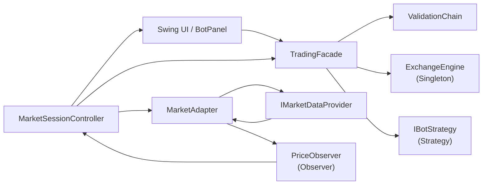
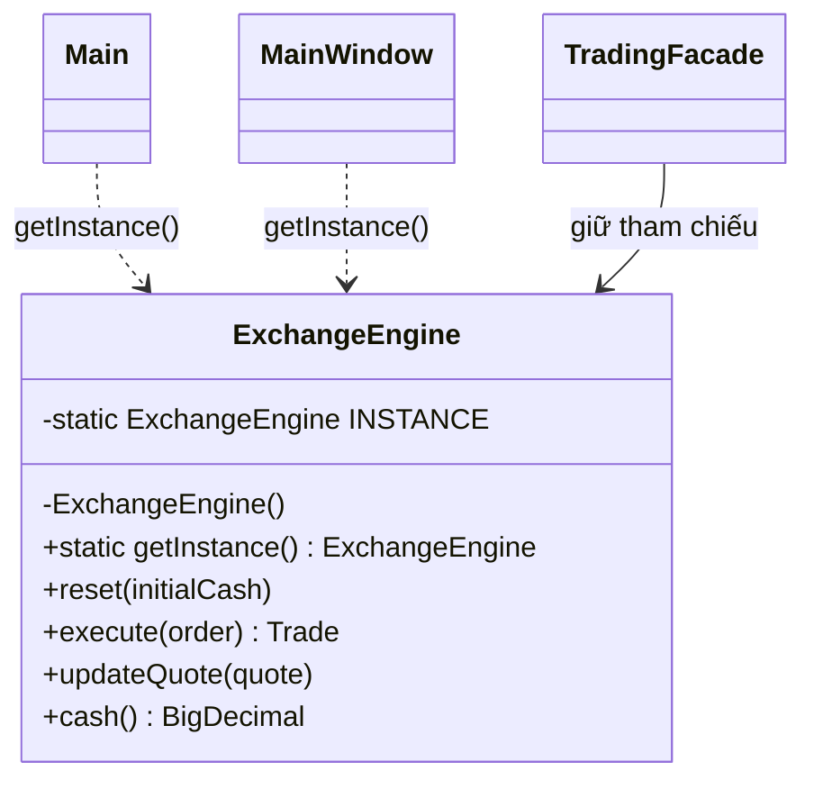
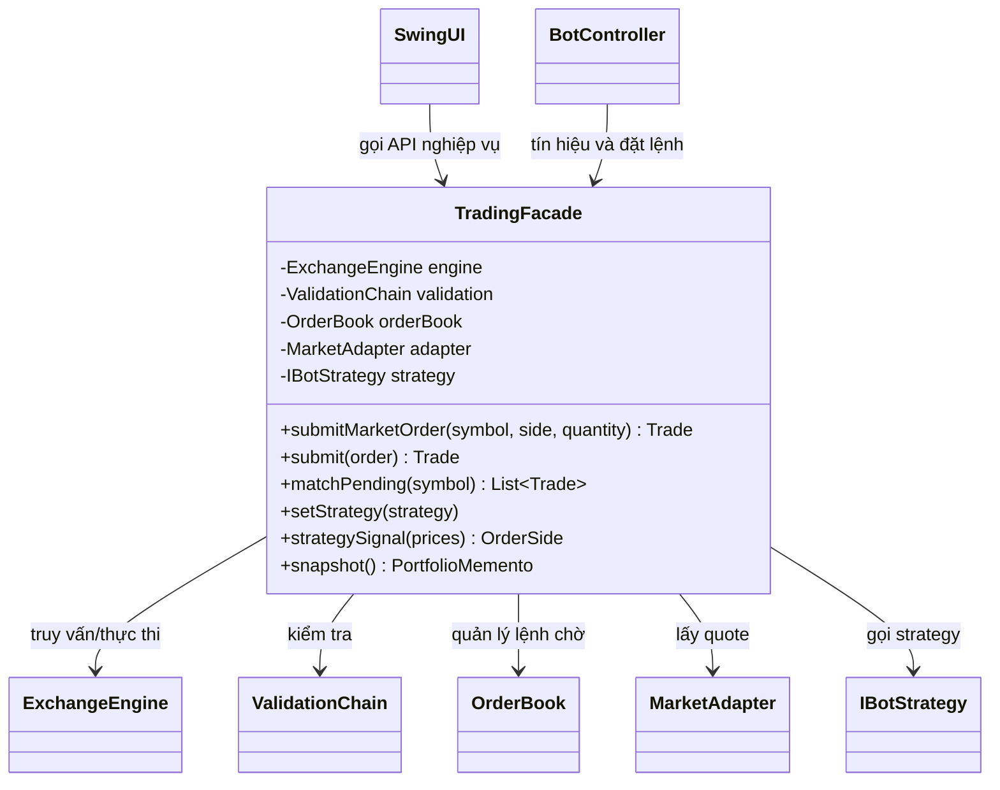
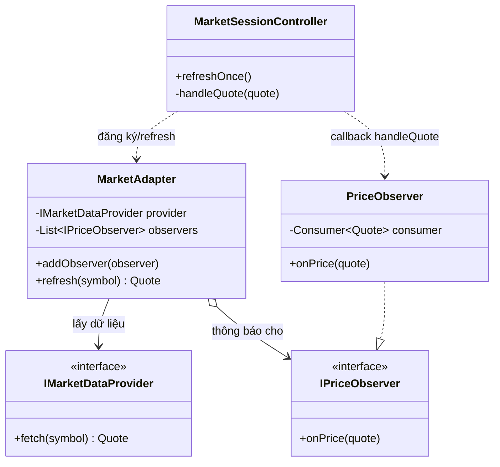
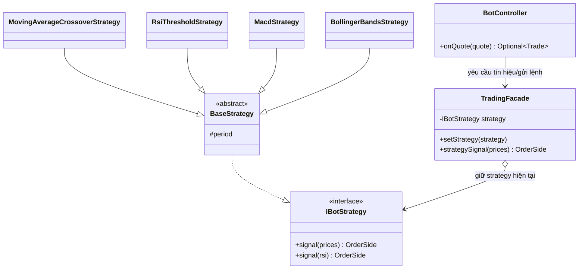

# Đặc tả phân tích mẫu thiết kế trong dự án

## 1. Mục đích và phạm vi

Tài liệu phân tích dự án mô phỏng giao dịch chứng khoán và mô tả một mẫu thiết kế tiêu biểu
cho mỗi thành viên. Nội dung dựa trên mã nguồn hiện tại, không phải thiết kế giả định hay hướng
dẫn tái cấu trúc toàn bộ ứng dụng.

Mỗi mẫu gồm: định nghĩa, mục đích, trường hợp sử dụng, vị trí trong dự án, sơ đồ lớp, cách xây
dựng và sử dụng, lý do áp dụng, ưu điểm và hạn chế. Bốn mẫu được chọn là **Singleton** (Phan Thành Huy),
**Facade** (Dương Văn Minh), **Observer** (Lê Thị Ánh Nhung) và **Strategy** (Lý Ngọc Thảo Nguyên).

## 2. Tóm tắt và kiến trúc dự án

Đây là ứng dụng Java 17 dùng Maven và Swing, mô phỏng giao dịch cổ phiếu ngoại tuyến. Người dùng
có thể xem giá, đặt lệnh Market/Limit/Stop-loss, theo dõi danh mục và chạy bot theo các chỉ báo
kỹ thuật. Tiền và giá giao dịch dùng `BigDecimal`; các chỉ báo kỹ thuật dùng `double` trong phép
tính. Dữ liệu giá mẫu được tạo từ provider mô phỏng hoặc đọc từ CSV, không cần kết nối sàn thật.

Luồng chính có thể tóm tắt như sau:



Các nhóm mẫu khác vẫn có trong dự án, nhưng không phải trọng tâm chi tiết của tài liệu:

| Thành viên | Các mẫu được phân công | Mẫu được phân tích trong tài liệu |
|---|---|---|
| Phan Thành Huy | Singleton, Factory Method | **Singleton** |
| Dương Văn Minh | Facade, Memento | **Facade** |
| Lê Thị Ánh Nhung | Adapter, Observer | **Observer** |
| Lý Ngọc Thảo Nguyên | Strategy, Chain of Responsibility | **Strategy** |

**Lưu ý về thuật ngữ:** dự án gọi `OrderFactory` là Factory Method. Tuy nhiên lớp này cung cấp
các phương thức tạo lệnh cụ thể ngay trong một lớp nhà máy, không có Creator/Concrete Creator
ghi đè factory method như cấu trúc GoF kinh điển. Do đó, tài liệu chọn Singleton làm ví dụ
chính của Phan Thành Huy để tránh đồng nhất hai biến thể mẫu thiết kế.

## 3. Thành viên 1 — Singleton (Creational Pattern)

### Định nghĩa

Singleton đảm bảo một lớp chỉ có một thể hiện được chia sẻ trong một phạm vi xác định, đồng thời
cung cấp điểm truy cập thống nhất tới thể hiện đó. Trong ứng dụng này, thể hiện được chia sẻ
trong cùng JVM/class loader; không nên hiểu là một thể hiện duy nhất trên nhiều tiến trình hay
nhiều JVM.

### Trường hợp sử dụng và vị trí áp dụng

Singleton phù hợp khi nhiều thành phần cần làm việc trên cùng một trạng thái nghiệp vụ, chẳng hạn
engine, cấu hình tiến trình hoặc bộ điều phối dùng chung. Dự án dùng mẫu này cho
[`ExchangeEngine`](../src/main/java/com/tradingsimulator/core/ExchangeEngine.java), nơi giữ tiền
mặt, vị thế, lịch sử giao dịch và báo giá hiện tại.

`Main` và `MainWindow` lấy cùng engine bằng `ExchangeEngine.getInstance()`, rồi truyền engine
cho `TradingFacade`. Kiểm thử `TestCore` xác nhận hai lần gọi `getInstance()` trả về cùng đối
tượng.

### Sơ đồ lớp



### Cách xây dựng và sử dụng

1. Đặt constructor ở mức `private` để mã bên ngoài không thể tạo engine mới.
2. Khai báo trường `static final` lưu thể hiện. Cách này khởi tạo eager khi lớp được nạp; lazy
   initialization là một lựa chọn triển khai khác, không phải điều kiện bắt buộc của Singleton.
3. Cung cấp `getInstance()` làm điểm truy cập công khai.
4. Dùng thể hiện dùng chung trong luồng nghiệp vụ; ở dự án này, truyền nó vào `TradingFacade`.
5. Đồng bộ hóa các thao tác đọc/ghi trạng thái dùng chung. Các thao tác nghiệp vụ của
   `ExchangeEngine` hiện được khai báo `synchronized`.

Ví dụ truy cập theo cách dự án đang làm:

```java
ExchangeEngine engine = ExchangeEngine.getInstance();
TradingFacade facade = new TradingFacade(engine);
```

### Vì sao dùng trong dự án

Ví dụ mô phỏng có một tài khoản và một sổ trạng thái giao dịch đang hoạt động. Dùng một engine
giúp giao diện, bot và các thao tác đặt lệnh nhìn thấy cùng số dư, vị thế và báo giá, tránh vô
tình cập nhật các bản sao trạng thái khác nhau.

### Ưu điểm

- Bảo đảm một nguồn trạng thái engine duy nhất trong tiến trình.
- Cách truy cập đơn giản, ít phải truyền engine qua nhiều tầng khởi tạo.
- Khởi tạo `static final` là khởi tạo sớm và an toàn khi nhiều luồng lớp cùng truy cập.
- Các phương thức trạng thái được đồng bộ hóa để giới hạn truy cập đồng thời không nhất quán.
- Có điểm truy cập chung mà không cần một biến toàn cục có thể gán lại.

### Nhược điểm và giới hạn

- Tạo trạng thái toàn cục có thể làm các thành phần phụ thuộc chặt vào engine.
- Khó chạy song song nhiều tài khoản, phiên mô phỏng hoặc cấu hình engine độc lập trong cùng
  tiến trình.
- Kiểm thử có thể bị ảnh hưởng bởi trạng thái dùng chung; cần reset dữ liệu rõ ràng giữa các test.
- Singleton không tự làm cho toàn bộ hệ thống an toàn luồng. Mọi thao tác truy cập trạng thái
  phải tuân thủ cùng quy tắc đồng bộ.
- Vì `ExchangeEngine` là `final`, có constructor `private` và điểm truy cập tĩnh, việc thay thế
  bằng lớp con/triển khai khác không nằm trong thiết kế hiện tại.
- Nếu trách nhiệm của engine tăng quá nhiều, Singleton có thể che giấu việc lớp đang ôm đồm
  nhiều nhiệm vụ.

Lazy initialization thường được nhắc tới như một lợi ích trong một số biến thể Singleton, nhưng
không phải yêu cầu chung và không được dùng ở `ExchangeEngine`. Singleton cũng nên được cân nhắc
theo nhu cầu thực tế; việc “không thể giao quyền sở hữu cho lớp khác” hay “phải khởi tạo chậm”
không phải bộ ba điều kiện bắt buộc theo định nghĩa mẫu.

## 4. Thành viên 2 — Facade (Structural Pattern)

### Định nghĩa

Facade cung cấp một giao diện cấp cao, dễ dùng cho một hoặc nhiều subsystem. Client gọi các thao
tác theo mục tiêu nghiệp vụ thay vì tự biết thứ tự phối hợp và chi tiết từng thành phần bên dưới.

### Trường hợp sử dụng và vị trí áp dụng

Facade phù hợp khi UI hoặc một client khác phải phối hợp nhiều dịch vụ để hoàn tất một hành động.
Dự án dùng [`TradingFacade`](../src/main/java/com/tradingsimulator/core/TradingFacade.java) làm
cổng giao dịch cho UI và bot. Facade giữ hoặc điều phối `ExchangeEngine`, `ValidationChain`,
`OrderBook`, `MarketAdapter` và `IBotStrategy`.

Ví dụ `submitMarketOrder` lấy báo giá, kiểm tra lệnh qua validation chain rồi yêu cầu engine
thực thi. `BotController` không trực tiếp quản lý engine: nó hỏi facade để lấy tín hiệu chiến
lược và gửi lệnh.

### Sơ đồ lớp



### Cách xây dựng và sử dụng

1. Xác định các luồng nghiệp vụ mà UI/bot cần, ví dụ đặt lệnh, đọc danh mục và lấy báo giá.
2. Tạo lớp facade nhận các subsystem cần phối hợp qua constructor hoặc cấu hình phụ thuộc.
3. Cung cấp phương thức có tên theo nghiệp vụ; bên trong điều phối validation, trạng thái và
   thực thi theo đúng thứ tự.
4. Khuyến nghị các client chính như UI và bot dùng facade cho luồng nghiệp vụ thông thường.
   Facade tạo lối vào đơn giản, nhưng không bắt buộc mọi client phải mất khả năng truy cập trực
   tiếp subsystem khi cần chức năng chuyên biệt.
5. Trả lỗi nghiệp vụ theo quy ước hiện có để client có thể thông báo hoặc xử lý.

Ví dụ tạo facade với engine dùng chung và đặt lệnh:

```java
TradingFacade facade = new TradingFacade(ExchangeEngine.getInstance());
facade.updateQuote(quote);
Trade trade = facade.submitMarketOrder("ABC", OrderSide.BUY, 5);
```

### Vì sao dùng trong dự án

UI và bot không nên phải lặp lại quy trình đọc quote, kiểm tra số dư/vị thế, xếp hàng lệnh chờ,
thực thi và cập nhật danh mục. Facade tập trung điểm vào này, giảm phụ thuộc của hai client lên
các chi tiết của trading engine và validation.

### Ưu điểm

- Đơn giản hóa API mà UI và bot cần biết.
- Giảm liên kết trực tiếp giữa client với nhiều subsystem.
- Tạo một nơi nhất quán để thực thi thứ tự nghiệp vụ như validate rồi mới execute.
- Dễ thay đổi một phần cách phối hợp bên trong mà không buộc UI gọi lại nhiều subsystem.

### Nhược điểm và giới hạn

- Facade có thể phình thành “God Object” nếu mọi nghiệp vụ đều được dồn vào một lớp.
- Client có thể bị phụ thuộc quá mức vào API facade; cần giữ phương thức theo mục tiêu nghiệp vụ,
  không biến facade thành bản sao toàn bộ API subsystem.
- Facade không thay thế validation, quyền truy cập hay quy tắc nghiệp vụ trong subsystem.
- Nếu facade bị xem là cổng duy nhất và không cung cấp thao tác nâng cao, người dùng chuyên sâu
  có thể không truy cập được độ linh hoạt của subsystem. Đây là quyết định API của ứng dụng,
  không phải yêu cầu bắt buộc của mẫu Facade.
- Trong mã hiện tại, `matchPending` giữ lệnh trong hàng chờ khi một lệnh kích hoạt không qua
  validation; hành vi này là chính sách cụ thể của luồng lệnh chờ, không phải thuộc tính bắt buộc
  của mẫu Facade.

## 5. Thành viên 3 — Observer (Behavioral Pattern)

### Định nghĩa

Observer định nghĩa quan hệ một-nhiều giữa đối tượng phát sự kiện (Subject) và các đối tượng
đăng ký nhận sự kiện (Observers). Khi trạng thái hoặc dữ liệu mới xuất hiện, Subject gửi thông
báo để các Observer tự phản ứng mà không cần client phát sự kiện biết chi tiết từng subscriber.
Trong dự án, `MarketAdapter` là publisher/Subject của sự kiện quote; nó không lưu mô hình giá
trung tâm mà lấy quote từ provider rồi đẩy quote đó tới các Observer theo mô hình push.

### Trường hợp sử dụng và vị trí áp dụng

Observer hữu ích cho dữ liệu thị trường thay đổi theo thời gian, khi nhiều thành phần cần nhận
cùng một quote mà không nên bị gắn cứng vào nơi tạo quote. Trong dự án,
[`MarketAdapter`](../src/main/java/com/tradingsimulator/marketdata/adapters/MarketAdapter.java)
lưu danh sách `IPriceObserver`. Phương thức `refresh` lấy quote từ provider rồi lần lượt gọi
`onPrice`.

`MarketSessionController` đăng ký `PriceObserver` với callback `handleQuote`. Callback này cập
nhật facade, khớp lệnh chờ, chạy bot và thông báo cho các listener giao diện.

### Sơ đồ lớp



### Cách xây dựng và sử dụng

1. Tách nguồn dữ liệu/sự kiện khỏi các phần tiêu thụ nó; ở đây dữ liệu sự kiện là `Quote`.
2. Tạo interface observer với phương thức nhận sự kiện như `onPrice(Quote)`; không bắt buộc
   phải dùng một lớp cơ sở trừu tượng hay kế thừa.
3. Cho Subject quản lý danh sách observer và cung cấp thao tác đăng ký. Cần thêm thao tác hủy
   đăng ký nếu vòng đời subscriber yêu cầu.
4. Khi có quote mới, phát sự kiện theo mô hình push (đưa quote trong lời gọi) hoặc pull (observer
   tự truy vấn Subject); chọn cách phù hợp với nhu cầu dữ liệu và hiệu năng.
5. Đăng ký observer lúc khởi tạo phiên; trong ứng dụng, `MarketSessionController` làm việc này.

Ví dụ rút gọn theo API hiện có:

```java
MarketAdapter adapter = new MarketAdapter(provider);
adapter.addObserver(new PriceObserver(this::handleQuote));
Quote quote = adapter.refresh("ABC");
```

### Vì sao dùng trong dự án

Mỗi quote mới có thể cần cập nhật nhiều nơi: danh mục, lệnh chờ, bot và bảng giá. Observer cho
phép luồng tạo quote phát sự kiện một lần; các bên tiêu thụ có thể đăng ký mà không bắt provider
phải biết danh sách cụ thể của chúng.

### Ưu điểm

- Giảm phụ thuộc trực tiếp giữa nơi phát quote và nơi sử dụng quote.
- Có thể thêm subscriber mới mà không phải thêm nhánh xử lý theo từng subscriber vào provider.
- Hợp với mô hình cập nhật định kỳ và các sự kiện giá.
- `IPriceObserver` tạo hợp đồng rõ ràng; `PriceObserver` hiện thực hóa hợp đồng bằng `Consumer`.
- Cho phép đăng ký observer trong thời gian chạy.

### Nhược điểm và giới hạn

- Thứ tự nhận thông báo có thể ảnh hưởng kết quả nếu subscriber làm thay đổi trạng thái dùng chung.
- Danh sách đăng ký khó quản lý vòng đời nếu không có thao tác hủy đăng ký; `MarketAdapter` hiện
  chỉ có `addObserver`.
- Subscriber chậm hoặc phát sinh lỗi có thể ảnh hưởng quá trình phát đồng bộ nếu không có chính
  sách cô lập lỗi hoặc hàng đợi sự kiện.
- Trong triển khai hiện tại, `refresh` gọi observer tuần tự trong cùng luồng; đây không phải hệ
  thống sự kiện bất đồng bộ.
- Push gửi toàn bộ quote có thể làm subscriber phụ thuộc vào cấu trúc dữ liệu sự kiện; pull giảm
  lượng dữ liệu đẩy nhưng subscriber phải truy vấn Subject và có thể phát sinh truy vấn thừa.
- Cần kiểm soát tần suất sự kiện để tránh subscriber bị quá tải khi quote cập nhật dồn dập.
- Không nên để observer phụ thuộc ngầm vào nhau; callback cần có trách nhiệm nhỏ và dễ kiểm thử.

## 6. Thành viên 4 — Strategy (Behavioral Pattern)

### Định nghĩa

Strategy đóng gói các thuật toán có cùng mục tiêu sau một interface chung, để client có thể thay
đổi thuật toán đang dùng mà không cần thay đổi code điều phối. Mỗi chiến lược độc lập thực hiện
một cách tính hoặc chính sách khác nhau.

### Trường hợp sử dụng và vị trí áp dụng

Strategy phù hợp khi bot có nhiều cách sinh tín hiệu. Dự án định nghĩa interface
[`IBotStrategy`](../src/main/java/com/tradingsimulator/tradingengine/botstrategies/IBotStrategy.java)
với các concrete strategy như `MovingAverageCrossoverStrategy`, `RsiThresholdStrategy`,
`MacdStrategy` và `BollingerBandsStrategy`.

`BotPanel` chọn strategy và cấu hình cho `TradingFacade`. Khi nhận quote, `BotController` tích lũy
lịch sử giá, hỏi facade gọi strategy để lấy `BUY`, `SELL` hoặc chưa có tín hiệu, rồi gửi lệnh
thông qua facade nếu bot đang bật.

### Sơ đồ lớp



### Cách xây dựng và sử dụng

1. Xác định kết quả chung của các thuật toán, ở đây là `OrderSide` hoặc `null` khi chưa đủ dữ
   liệu/không có tín hiệu.
2. Định nghĩa interface `IBotStrategy` để mọi thuật toán cùng tuân thủ.
3. Viết từng thuật toán thành một lớp riêng; dùng lớp cơ sở nếu cần dùng chung tham số hoặc logic.
4. Cho context giữ một tham chiếu interface, không phụ thuộc vào lớp chiến lược cụ thể.
5. Cấu hình hoặc thay chiến lược ở runtime; client chỉ gọi `signal` theo hợp đồng chung.
6. Kiểm thử từng thuật toán độc lập với cùng kiểu đầu vào/đầu ra.

Ví dụ sử dụng:

```java
TradingFacade facade = new TradingFacade(ExchangeEngine.getInstance());
facade.setStrategy(new MovingAverageCrossoverStrategy(3));
OrderSide signal = facade.strategySignal(prices);
```

### Vì sao dùng trong dự án

Bot cần thử nhiều quy tắc giao dịch nhưng không nên sửa `BotController` mỗi khi thêm hoặc đổi
cách phân tích. Strategy giữ phần tính tín hiệu riêng khỏi quy trình tích lũy giá và đặt lệnh.

### Ưu điểm

- Có thể thay đổi thuật toán tại runtime qua `setStrategy`.
- Mỗi strategy độc lập, dễ kiểm thử với chuỗi dữ liệu đầu vào cụ thể.
- Thêm chiến lược mới thường không yêu cầu sửa luồng điều phối của `BotController`.
- Tránh chuỗi `if/else` lớn trong client để phân biệt từng thuật toán.
- Hỗ trợ nguyên tắc Open-Closed: có thể bổ sung một concrete strategy mà không phải viết lại
  client điều phối, miễn là strategy tuân thủ interface chung.

### Nhược điểm và giới hạn

- Mỗi thuật toán mới thêm một lớp và có thể làm tăng số lượng thành phần.
- Client hoặc cấu hình UI vẫn cần biết chiến lược nào được chọn.
- Interface quá tổng quát có thể dẫn tới tham số không cần thiết hoặc kết quả `null` khó phân biệt
  với dữ liệu lỗi; cần quy ước và kiểm thử rõ.
- Các chiến lược có thể cần dữ liệu khác nhau. Dự án hiện cung cấp cả tín hiệu theo danh sách giá
  và overload theo RSI; cần giữ hợp đồng nhất quán khi mở rộng.
- Strategy chỉ sinh tín hiệu; nó không đảm bảo lệnh phù hợp số dư/vị thế. Validation và thực thi
  vẫn thuộc luồng facade/engine.
- Có thể chia sẻ đối tượng Strategy như Flyweight chỉ khi trạng thái của nó cho phép dùng chung
  an toàn; đây không phải ưu điểm tự động của Strategy. Các strategy có tham số như chu kỳ hoặc
  ngưỡng thường cần cấu hình riêng.

## 7. Xây dựng, chạy và kiểm chứng dự án

### Yêu cầu

- JDK 17
- Maven
- Thư viện đã có trong cache Maven cục bộ của dự án để chạy chế độ offline

### Lệnh kiểm thử

Chạy tại thư mục gốc dự án:

```powershell
mvn -o -Dmaven.repo.local=.m2 test
```

Các test liên quan gồm `TestCore` (Singleton và luồng Facade), `TestPatterns` (một số mẫu),
`TestStrategies` (Strategy), cùng các test integration, validation và market data.

### Chạy ứng dụng

```powershell
mvn -o -Dmaven.repo.local=.m2 exec:java
mvn -o -Dmaven.repo.local=.m2 exec:java -Dexec.args=--ui
```

## 8. Tài liệu mã nguồn tham chiếu

- [ExchangeEngine](../src/main/java/com/tradingsimulator/core/ExchangeEngine.java)
- [TradingFacade](../src/main/java/com/tradingsimulator/core/TradingFacade.java)
- [MarketAdapter](../src/main/java/com/tradingsimulator/marketdata/adapters/MarketAdapter.java)
- [IPriceObserver](../src/main/java/com/tradingsimulator/marketdata/observers/IPriceObserver.java)
- [PriceObserver](../src/main/java/com/tradingsimulator/marketdata/observers/PriceObserver.java)
- [MarketSessionController](../src/main/java/com/tradingsimulator/ui/session/MarketSessionController.java)
- [IBotStrategy](../src/main/java/com/tradingsimulator/tradingengine/botstrategies/IBotStrategy.java)
- [BotController](../src/main/java/com/tradingsimulator/ui/bot/BotController.java)
- [TestCore](../src/test/java/com/tradingsimulator/TestCore.java)
- [TestPatterns](../src/test/java/com/tradingsimulator/TestPatterns.java)
- [TestStrategies](../src/test/java/com/tradingsimulator/TestStrategies.java)
